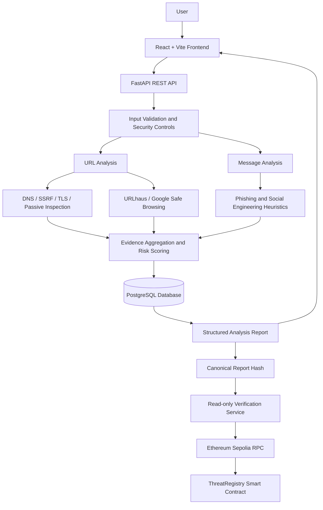

# Nexus — Cybersecurity & Threat Intelligence

[](https://www.python.org/)
[](https://fastapi.tiangolo.com/)
[](https://www.postgresql.org/)
[](https://ethereum.org/en/developers/docs/networks/)

## README Sections

1. [01. Project Name and One-Line Description](#01-project-name-and-one-line-description)
2. [02. Problem](#02-problem)
3. [03. Solution](#03-solution)
4. [04. Demo Links and a Screenshot](#04-demo-links-and-a-screenshot)
5. [05. Tech Stack](#05-tech-stack)
6. [06. Architecture](#06-architecture)
7. [07. Setup and Run Steps](#07-setup-and-run-steps)
8. [08. Disclosures](#08-disclosures)
9. [09. Track](#09-track)

---

## 01. Project Name and One-Line Description

### Nexus
**An evidence-backed threat intelligence platform that analyzes suspicious URLs and messages, explains risk, and supports verifiable report integrity using blockchain.**

Nexus helps users and security teams make better-informed decisions by bringing URL inspection, suspicious-message analysis, threat-intelligence signals, risk scoring, and report verification into one platform. It produces structured findings with evidence and clear provider statuses instead of presenting an unexplained safe/unsafe label.

The live demo consists of a web frontend and a FastAPI backend. The backend and supporting smart-contract workspace are maintained in this repository.

## 02. Problem

People encounter phishing links, fraudulent messages, impersonation attempts, and suspicious websites every day. Checking these threats often requires switching between disconnected tools. Results can be difficult to interpret, and a missing threat-intelligence match is easily mistaken for proof that something is safe.

There is also a trust problem: after an analysis is generated, users need a way to check whether a stored report has been altered. A conventional database record alone does not provide independent, tamper-evident proof of its integrity.

Nexus focuses on these gaps:
- Threat signals are scattered across different tools and providers.
- Users may not understand why a URL or message is considered suspicious.
- Provider outages and unavailable data can lead to misleading conclusions.
- Report integrity needs to be verifiable without publishing sensitive URLs or message contents on-chain.

## 03. Solution

Nexus provides a unified threat-analysis workflow with explainable findings and a blockchain-backed integrity layer.

### Core capabilities

- **URL threat analysis:** validates HTTP(S) URLs, applies DNS and SSRF protections, checks TLS, and performs bounded passive website inspection.
- **Message threat analysis:** detects supported phishing patterns such as urgency manipulation, credential harvesting language, suspicious links, payment pressure, and possible impersonation.
- **Threat-intelligence signals:** integrates URLhaus and Google Safe Browsing when credentials are configured. Provider outcomes distinguish matches, no-match responses, unavailable services, rate limits, and errors.
- **Risk scoring:** returns a score and a classification such as `LOW`, `SUSPICIOUS`, `HIGH`, `CONFIRMED_MALICIOUS`, or `INCONCLUSIVE`.
- **Evidence-backed reports:** returns structured findings, explanations, recommendations, and report identifiers.
- **Report persistence:** stores report data off-chain in the configured database.
- **Blockchain integrity verification:** supports read-only verification of a report hash commitment and its transaction evidence on Ethereum Sepolia.
- **Public demo access:** selected analysis and verification endpoints can be exposed for the public demo, while sensitive dashboard, report retrieval, and blockchain registration operations remain protected by backend configuration.

### What makes Nexus different

Nexus does not simply return a risk label. It shows the signals behind the result and communicates when evidence is missing or a provider could not be reached. Blockchain is used for report-integrity evidence—not as a source of threat intelligence and not as proof that an analysis is factually correct.

## 04. Demo Links and a Screenshot

| Resource | Link |
|---|---|
| **Live frontend demo** | [https://code-nexus-five.vercel.app/](https://code-nexus-five.vercel.app/) |
| **Live backend** | [https://code-nexus-3ocs.onrender.com/](https://code-nexus-3ocs.onrender.com/) |
| **API documentation (Swagger)** | [https://code-nexus-3ocs.onrender.com/docs](https://code-nexus-3ocs.onrender.com/docs) |
| Backend health | [https://code-nexus-3ocs.onrender.com/health](https://code-nexus-3ocs.onrender.com/health) |
| Backend readiness | [https://code-nexus-3ocs.onrender.com/health/ready](https://code-nexus-3ocs.onrender.com/health/ready) |
| GitHub repository | [https://github.com/DevAyushTech/Code-Nexus](https://github.com/DevAyushTech/Code-Nexus) |

### Demo walkthrough

1. Open the frontend and navigate to **Threat Console**.
2. Submit a URL for analysis.
3. Review the risk score, classification, findings, and available integration results.
4. Switch to message analysis and submit a suspicious message for inspection.
5. Use the report's verification option to check its blockchain commitment where a commitment has already been registered.

**Screenshot:** Add an authentic screenshot of the deployed Threat Console/report view at `docs/images/nexus-demo.png`. Once added, display it here using:

```markdown

```

No screenshot is embedded yet because a verified project screenshot has not been committed to this repository.

## 05. Tech Stack

| Layer | Technologies |
|---|---|
| Frontend | React, Vite, Tailwind CSS |
| Backend API | Python 3.11+, FastAPI, Uvicorn, Pydantic Settings, HTTPX |
| Database | PostgreSQL, SQLAlchemy 2, Alembic; SQLite for local development |
| Threat analysis | Python analysis services, DNS/SSRF safeguards, TLS inspection, passive website inspection |
| Threat intelligence | URLhaus, Google Safe Browsing (when configured) |
| Blockchain | Solidity 0.8.24, Hardhat, ethers, OpenZeppelin, Web3.py |
| Network | Ethereum Sepolia test network |
| Deployment | Vercel (frontend), Render (backend), Docker |
| Testing | pytest, pytest-asyncio, Hardhat/Mocha contract tests |

## 06. Architecture

Nexus uses a web frontend connected to a modular FastAPI backend through REST APIs. Analysis and report data remain off-chain in the configured database. The blockchain layer stores only a cryptographic commitment and associated registry metadata.

### High-level workflow

1. A user submits a URL or message through the frontend.
2. The frontend sends the request to the FastAPI backend.
3. The backend validates the input and applies the relevant analysis services.
4. URL analysis can perform DNS/SSRF checks, TLS inspection, passive website inspection, and configured provider lookups.
5. Message analysis evaluates supported phishing and social-engineering indicators.
6. The backend calculates a risk score, creates structured findings, and persists the report.
7. The user receives the result and a report ID.
8. Where a report commitment has been registered, the verification endpoint can check it against Ethereum Sepolia using read-only blockchain calls.

### Architecture diagram



### On-chain and off-chain separation

- **Off-chain:** report content, analysis findings, target/message data, and structured evidence are stored by the backend.
- **On-chain:** the registry stores a cryptographic report commitment and registry metadata; raw URLs and message contents are not written to the contract.
- **Verification:** the backend recomputes the report commitment and checks the existing Sepolia record and transaction evidence.
- **Important:** verification demonstrates a match with the registered commitment. It does not prove that the report's original analysis was correct.

Configured historical Sepolia deployment: chain ID `11155111`; ThreatRegistry address `0x0477964F49Ce37516dBFfFA3a16c8dDE73D58Bf4`.

## 07. Setup and Run Steps

### Prerequisites

- Python 3.11+
- Node.js and npm (for the smart-contract workspace)
- Git
- Docker Desktop (optional, for Docker Compose)
- PostgreSQL (optional when using the default local SQLite configuration)

### 1. Clone the repository

```powershell
git clone https://github.com/DevAyushTech/Code-Nexus.git
cd Code-Nexus
```

### 2. Configure the backend

```powershell
cd backend
py -3.11 -m venv .venv
.\.venv\Scripts\python.exe -m pip install --upgrade pip
.\.venv\Scripts\python.exe -m pip install -r requirements.txt
Copy-Item .env.example .env
```

Edit `.env` locally if required. Never commit `.env`, API keys, database URLs, RPC credentials, or private keys.

For local development, the default configuration can use SQLite. Review `backend/.env.example` for the current environment-variable names and safe defaults.

### 3. Run database migrations

From the `backend` directory:

```powershell
.\.venv\Scripts\python.exe -m alembic upgrade head
```

Run migrations only against a database whose target and backup you have confirmed. Do not reset or recreate an existing database.

### 4. Start the backend

From the `backend` directory:

```powershell
.\.venv\Scripts\python.exe -m uvicorn app.main:app --reload --host 127.0.0.1 --port 8000
```

Open:
- API documentation: [http://localhost:8000/docs](http://localhost:8000/docs)
- Health: [http://localhost:8000/health](http://localhost:8000/health)
- Readiness: [http://localhost:8000/health/ready](http://localhost:8000/health/ready)

### 5. Run the frontend

The frontend source is maintained in the repository's `frontend` directory. In a second terminal:

```powershell
cd frontend
npm install
npm run dev
```

Configure the frontend's backend API base URL using the environment-variable name expected by the frontend project. Do not put private backend API keys or server credentials in Vite client-side environment variables.

### 6. Optional: contract workspace

Use the contract workspace only when you intend to work on or test the smart contracts. From the directory containing its `package.json`:

```bash
npm install
npm run compile
npm run test:contracts
npm run export:abi
npm run validate:deployment
```

Contract deployment is a separate manual operation. It is not required to run the web application. Do not deploy to mainnet or expose private keys.

### 7. Optional: Docker Compose

Docker Compose can run the API and PostgreSQL services. Set required environment variables securely outside source control, then run:

```powershell
docker compose up --build
```

For a new, disposable database only, apply migrations using the documented backend migration command. Do not run migration or reset commands against an unknown or existing production database.

### Troubleshooting

| Issue | What to check |
|---|---|
| API returns `401` | Check the configured authentication mode and whether the route is public or protected. Never expose a private API key in browser code. |
| Readiness returns `503` | Check database connectivity, `DATABASE_URL`, and migration state. |
| Provider is `not_configured` or `unavailable` | Check provider configuration and remember that missing provider evidence is not proof of safety. |
| Blockchain verification is unavailable | Check Web3 packaging, ABI availability, Sepolia RPC reachability, chain ID, and contract address. |
| Browser reports a CORS error | Add the exact frontend origin to the backend's `CORS_ORIGINS` configuration. |

## 08. Disclosures

- Nexus is a decision-support and threat-analysis tool. It does not guarantee that a URL, website, or message is safe.
- A provider returning no match is not proof that an indicator is harmless.
- Provider coverage is limited and can be affected by outages, quotas, rate limits, and configuration.
- States such as `INCONCLUSIVE`, `not_configured`, `unavailable`, `rate_limited`, and `error` indicate incomplete or unavailable evidence.
- Optional AI output is advisory and may be incomplete or incorrect; it is not the authoritative risk decision.
- Blockchain verification checks report-hash integrity against an existing on-chain commitment. It does not establish the truthfulness or accuracy of the report.
- Ethereum Sepolia is a test network, not Ethereum mainnet.
- Public demo mode exposes only selected endpoints. Sensitive report retrieval, dashboard/feed operations, and blockchain registration are intended to remain protected by backend configuration.
- The current demo authentication controls should not be represented as a complete multi-user identity, authorization, or RBAC system.
- The live demo and external provider integrations depend on third-party availability and deployment configuration.
- Use only URLs and messages you are authorized to analyze. Avoid submitting personal data, credentials, or confidential content to external providers.

## 09. Track

**Cybersecurity, Threat Intelligence & Digital Trust Infrastructure**
