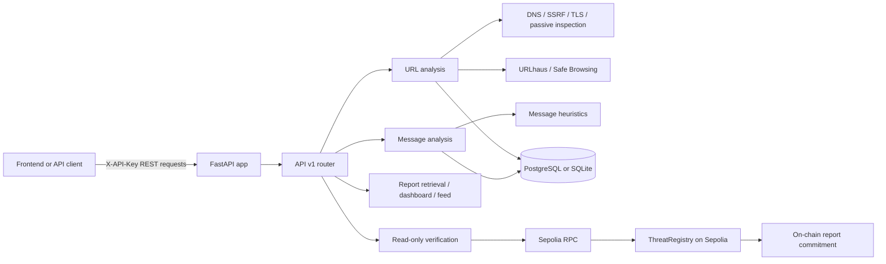
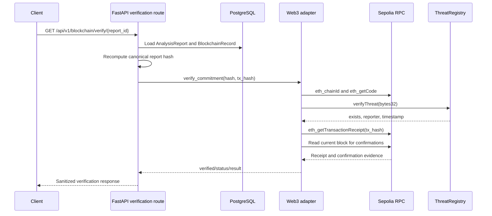

# Nexus

[](https://www.python.org/)
[](https://fastapi.tiangolo.com/)
[](https://www.postgresql.org/)
[](https://ethereum.org/en/developers/docs/networks/)

Nexus is an evidence-backed threat-intelligence backend that analyzes URLs and messages, stores structured reports, and supports read-only verification of report integrity commitments on Ethereum Sepolia.

## Table of Contents

1. [01. Project Name and One-Line Description](#01-project-name-and-one-line-description)
2. [02. Problem](#02-problem)
3. [03. Solution](#03-solution)
4. [04. Demo Links and a Screenshot](#04-demo-links-and-a-screenshot)
5. [05. Tech Stack](#05-tech-stack)
6. [06. Architecture](#06-architecture)
7. [07. Setup and Run Steps](#07-setup-and-run-steps)
8. [08. Disclosures](#08-disclosures)
9. [09. Track](#09-track)

## 01. Project Name and One-Line Description

**Nexus — evidence-backed URL and message threat analysis with verifiable report integrity.**

Nexus is designed to make threat-analysis results easier to inspect: deterministic findings, TLS and website observations, optional external threat-intelligence evidence, risk classification, and persisted report identifiers are returned through a documented FastAPI API. A report can also be checked against an existing commitment recorded by the Nexus threat registry on Sepolia.

This repository contains the backend and the supporting smart-contract development workspace. No frontend application source is tracked in this repository.

## 02. Problem

Online threat signals are difficult to interpret when URL behavior, message content, certificate details, passive website observations, and provider results are separated across different tools. A provider returning no match is also easy to confuse with proof that an indicator is safe, while an unavailable provider can be mistaken for a clean result.

Nexus addresses this specific problem by returning findings with evidence, source, explanations, recommendations, and confidence, alongside explicit provider states. Persisted reports provide a stable record for retrieval, while a cryptographic commitment can provide integrity evidence that is independent of the database copy.

Nexus does not determine the truth of every report or replace analyst judgment. It is a structured decision-support service for the implemented checks and integrations.

## 03. Solution

### Implemented

- **URL analysis:** validates HTTP(S) input, rejects unsafe destinations, performs DNS/SSRF checks, validates TLS, performs bounded passive website inspection, and produces deterministic findings.
- **Message analysis:** identifies supported urgency, payment, credential-harvesting, suspicious-link, and possible-impersonation patterns.
- **Threat intelligence:** integrates URLhaus and Google Safe Browsing when configured. Results distinguish matches, successful no-match responses, unavailable providers, rate limits, errors, and inconclusive results.
- **Risk classification:** produces a bounded risk score and classifications including `LOW`, `SUSPICIOUS`, `HIGH`, `CONFIRMED_MALICIOUS`, and `INCONCLUSIVE`.
- **Reports:** persists analysis reports and returns report IDs for later retrieval. New URL query values and message contents are redacted from report responses and persistence paths.
- **Threat feed and dashboard:** provides dashboard classification counts, paginated threat reports, and optional threat-report type filtering.
- **Blockchain integrity:** computes the canonical report commitment from report metadata and supports read-only Sepolia verification of the existing commitment and transaction evidence.

### Optional or operationally restricted

- Advisory AI analysis is disabled by default and is not authoritative.
- Blockchain registration is an authenticated backend operation; it is not a frontend signing flow and must not be invoked automatically.
- Mock blockchain mode is available for local tests and explicitly does not represent Ethereum state.

## 04. Demo Links and a Screenshot

| Resource | Link |
|---|---|
| Live backend | [https://code-nexus-3ocs.onrender.com/](https://code-nexus-3ocs.onrender.com/) |
| API documentation | [https://code-nexus-3ocs.onrender.com/docs](https://code-nexus-3ocs.onrender.com/docs) |
| Health | [https://code-nexus-3ocs.onrender.com/health](https://code-nexus-3ocs.onrender.com/health) |
| Readiness | [https://code-nexus-3ocs.onrender.com/health/ready](https://code-nexus-3ocs.onrender.com/health/ready) |
| GitHub repository | [https://github.com/DevAyushTech/Code-Nexus](https://github.com/DevAyushTech/Code-Nexus) |

**Frontend demo URL:** Not verified. No frontend application or frontend deployment URL is documented in this repository.

### Screenshot

No screenshot asset was found in the repository. Add a real project screenshot at `docs/images/nexus-demo.png` and replace this note with:

```markdown

```

Do not add a generated or unrelated image.

## 05. Tech Stack

| Area | Technologies confirmed in the repository |
|---|---|
| Frontend | No frontend source is tracked; integration is documented through REST/OpenAPI handover materials. |
| Backend | Python 3.11, FastAPI, Uvicorn, Pydantic Settings, HTTPX |
| Persistence | SQLAlchemy 2, SQLite for local development, PostgreSQL with `psycopg`, Alembic |
| Blockchain | Solidity `0.8.24`, Hardhat, ethers, OpenZeppelin contracts, Web3.py, Ethereum Sepolia |
| Threat analysis | Deterministic URL/message analysis, DNS/SSRF protections, TLS inspection, passive website inspection |
| Threat intelligence | URLhaus and Google Safe Browsing adapters |
| Optional analysis | Configurable advisory AI integration through the implemented provider adapters |
| Infrastructure | Docker, Docker Compose, PostgreSQL 16 Alpine image, Render deployment references |
| Testing | pytest, pytest-asyncio, Hardhat/Mocha contract tests |

## 06. Architecture

Nexus is a backend modular monolith. API routes coordinate validation, analysis services, persistence, provider evidence, and blockchain verification. The local database is SQLite; the Compose and staging deployment path uses PostgreSQL. The frontend integration contract is REST/OpenAPI-based, but the frontend itself is maintained outside this repository.

### Analysis workflow

1. A protected API request reaches the FastAPI router with `X-API-Key`.
2. URL or message input is validated.
3. Analysis services generate deterministic findings and risk classification.
4. URL analysis may query URLhaus, Google Safe Browsing, TLS inspection, and passive website inspection.
5. The report and structured evidence are persisted off-chain.
6. The API returns the report ID and response schema.

### Blockchain workflow

- Off-chain report metadata is stored in PostgreSQL or SQLite.
- The canonical SHA-256 report commitment is derived from the report ID, target hash, classification, and risk score.
- The corresponding commitment is stored by the deployed `ThreatRegistry` contract on Ethereum Sepolia.
- Read-only verification recomputes the local commitment, calls `verifyThreat(bytes32)`, checks the existing receipt when available, and enforces confirmation depth.
- Verification does not submit a transaction.

The configured historical deployment is documented as chain ID `11155111` with contract address `0x0477964F49Ce37516dBFfFA3a16c8dDE73D58Bf4`. The contract stores a commitment, reporter, timestamp, and existence flag; it does not store raw URLs or messages.



### Report verification sequence



## 07. Setup and Run Steps

### Prerequisites

- Python 3.11+
- Node.js and npm for the Hardhat contract workspace
- Docker Desktop only if using Docker Compose
- PostgreSQL only if running outside the default local SQLite setup

### Clone the repository

```powershell
git clone https://github.com/DevAyushTech/Code-Nexus.git
cd Code-Nexus
```

### Backend setup — Windows PowerShell

```powershell
cd backend
py -3.11 -m venv .venv
.\.venv\Scripts\python.exe -m pip install --upgrade pip
.\.venv\Scripts\python.exe -m pip install -r requirements.txt
Copy-Item .env.example .env
```

Edit `.env` locally as needed. Never commit `.env`, API keys, RPC credentials, database URLs, or private keys. The safe template is [`backend/.env.example`](backend/.env.example).

Local development defaults to SQLite:

```text
DATABASE_URL=sqlite:///./nexus.db
API_AUTH_MODE=demo
```

For a protected demo, use `API_AUTH_MODE=protected_demo` and provide a non-empty `API_AUTH_KEY` through the deployment environment. Configure the exact frontend origin in `CORS_ORIGINS`.

### Database setup

For a new database, run the migration command from `backend`:

```powershell
.\.venv\Scripts\python.exe -m alembic upgrade head
```

The existing local database must not be reset or recreated. Back it up and verify its schema before any migration adoption work. Migrations are manual; the Dockerfile and application startup do not run them automatically.

### Start the backend

Windows:

```powershell
.\.venv\Scripts\python.exe -m uvicorn app.main:app --reload --host 127.0.0.1 --port 8000
```

Linux/macOS:

```bash
python3.11 -m venv .venv
. .venv/bin/activate
python -m pip install -r requirements.txt
python -m uvicorn app.main:app --reload --host 127.0.0.1 --port 8000
```

OpenAPI is available at [http://localhost:8000/docs](http://localhost:8000/docs). Public checks are:

```text
GET /health
GET /health/ready
```

All `/api/v1` analysis, report, dashboard, feed, threat-report, and blockchain routes require `X-API-Key` when a key is configured.

### Contract workspace

From `backend`:

```powershell
npm install
npm run compile
npm run test:contracts
npm run export:abi
npm run validate:deployment
```

Contract deployment is manual and is not part of application startup or automated backend tests. Do not use a mainnet network or key. Do not run deployment commands unless you intend to perform a separate, approved blockchain operation.

### Docker Compose

Docker Compose provides PostgreSQL and the API:

```powershell
$env:POSTGRES_PASSWORD = "<set outside source control>"
$env:API_AUTH_KEY = "<set outside source control>"
docker compose up --build
```

Compose requires external credentials and waits for PostgreSQL health. For a fresh disposable Compose database only:

```powershell
docker compose run --rm api python -m alembic upgrade head
```

Do not run this against the existing local database or an unknown production database. The API container starts with `uvicorn app.main:app`; it does not migrate automatically.

### Troubleshooting

| Symptom | Check |
|---|---|
| `401` on an API route | Confirm protected-demo mode and send the configured `X-API-Key` through a trusted server-side boundary. |
| Readiness returns `503` | Check `DATABASE_URL`, database availability, and migration state. |
| Provider is `not_configured` or `unavailable` | Check the provider configuration and remember that provider failure is not a clean verdict. |
| Blockchain verification is `rpc_unavailable` | Check Web3 dependency packaging, ABI packaging, Sepolia RPC reachability, chain ID, and contract address. Verification is read-only. |
| CORS failure | Add the exact frontend origin to `CORS_ORIGINS`; do not use a wildcard with a secret API key architecture. |

## 08. Disclosures

- Nexus is a security decision-support tool, not a guarantee that a URL or message is safe.
- A provider no-match means that provider returned no match; it is not proof of safety.
- Provider APIs can have limited coverage, outages, rate limits, quotas, or configuration requirements.
- `INCONCLUSIVE`, `not_configured`, `unavailable`, `rate_limited`, `error`, and similar states mean that evidence is incomplete or unavailable.
- Optional AI output is advisory and may be incomplete or incorrect. It is not the authoritative risk decision.
- Blockchain verification proves that a particular report hash and transaction evidence match the on-chain commitment. It does not prove that the original report was truthful.
- Sepolia is an Ethereum test network, not Ethereum mainnet.
- The current authentication model is a shared demo/admin API key, not multi-user authentication or RBAC.
- The rate limiter is process-local and intended for a single-worker demo; multiple workers or instances do not share counters.
- PostgreSQL compatibility, Docker execution, and frontend integration require validation in the target deployment environment. Do not infer them from mocked tests alone.
- Live provider checks have limited scope; mocked provider tests do not prove continuous external availability.
- No frontend source or verified frontend demo URL is included in this repository.

Use the system only with authorized inputs. Do not submit private data, credentials, or raw sensitive content to external providers or the blockchain.

## 09. Track

Track: To be confirmed by the project team
